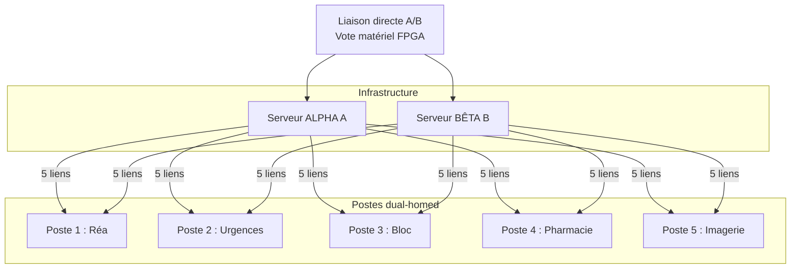
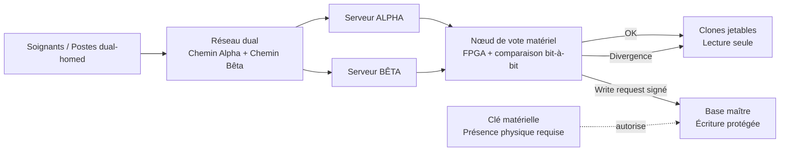
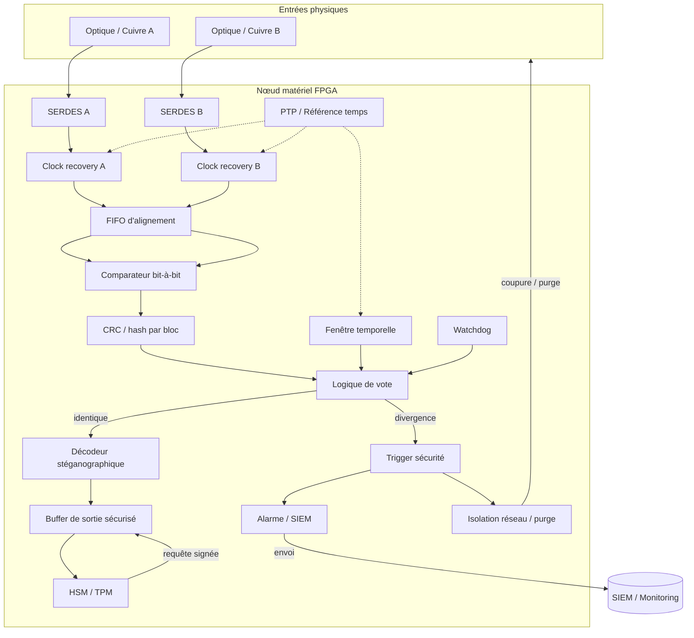

# Livre Blanc : Écosystème Octet-Économe et Architecture en Miroir Destructif

Le web moderne souffre d'une obésité structurelle et d'une vulnérabilité systémique face à l'évolution des attaques de type ransomware et des compromissions de réseaux internes. Ce document présente une architecture de résilience fondée sur un pari conceptuel : au lieu d'isoler les menaces par la logique, on les neutralise au niveau matériel et signal en multipliant les chemins, la redondance et le vote binaire.

## 1. Le Protocole Octet-Économe : Web Binaire et Stéganographie
Le code HTML verbeux est remplacé par un flux binaire natif, éliminant la charge d'analyse syntaxique.

* **Compression Matérielle (Le Bit Unique) :** L'encodage quitte la norme ASCII de 8 bits. Il repose sur un arbre de Huffman asymétrique intégré directement dans un navigateur dédié ou au niveau du noyau de traitement.
* **Chiffrement par l'Espacement :** La donnée n'est pas protégée par une altération mathématique des caractères. L'encodage structurel repose sur la gestion des espaces, rendant l'information dissimulée dans la géométrie du flux.
* **Écologie Numérique :** Ce format binaire garantit un gain de stockage significatif à la source, réduisant l'empreinte carbone des serveurs et les besoins en bande passante.

## 2. Le Miroir Destructif : Sécurité Asymétrique Absolue
Le système délaisse la défense périmétrique logicielle classique au profit d'une architecture de leurres réactifs.

* **Essaim de Clones Inversés :** Les utilisateurs n'ont jamais accès à la base de données mère et interagissent exclusivement avec un essaim de clones jetables.
* **Destruction Réactive :** Un processus de vérification observe le clone. Au premier octet modifié par un processus non autorisé, le clone est instantanément isolé et purgé.
* **Séparation Physique des Privilèges :** L'application d'une modification sur la base de données maître nécessite obligatoirement l'insertion d'une clé cryptographique matérielle par un administrateur physiquement présent.

### Architecture de redondance physique et de vote matériel

La topologie ci-dessous illustre le principe de redondance active et de validation bit-à-bit entre deux chemins indépendants :



Cette architecture vise à éliminer tout point de rupture unique : les serveurs Alpha et Bêta fonctionnent en miroir, les postes sont dual-homed sur les deux chemins, et la comparaison bit à bit est assurée par un mécanisme de vote matériel en temps réel.

### Vue système — Niveau 0



### Vue matérielle / signal — Niveau 2 (FPGA + logique de vote)



Le nœud de vote FPGA constitue le cœur de l'architecture. Il compare les flux Alpha et Bêta bit-à-bit sur deux chemins physiques indépendants, en maintenant un alignement temporel strict et un déclenchement immédiat en cas de divergence. La logique de sécurité agit alors sur les points de coupure physiques et la purge des segments compromis.

## 3. Feuille de Route et Appel aux Contributeurs

Ce modèle nécessite un effort communautaire open-source pour passer de la conception théorique à l'implémentation mondiale.

* **Ingénierie Bas Niveau (C, Rust, WebAssembly) :** Création du compilateur textuel vers binaire avec respect de l'arbre asymétrique (Espace = bit 1), et développement du moteur de rendu pour le navigateur dédié.
* **Architecture Réseau :** Conception du protocole de transmission propriétaire empêchant toute rétro-ingénierie d'un flux intercepté.
* **Sécurité Offensive (Red Team) :** Audit des mécanismes de vérification en miroir et validation de la vitesse d'autodestruction face aux scripts d'exploitation automatisés.

---

## ANNEXE : Preuve de Concept - Compilateur Asymétrique Octet-Économe

La preuve de concept originale (un script Python inclus dans la version précédente du document) a été extraite vers tools/octet_compressor.py. Ce script fournit :

- la génération d'un dictionnaire de codes asymétriques (espace = '1'),
- l'encodage d'un texte en un fichier binaire .octet (en-tête JSON contenant la table de codes + payload binaire),
- le décodage pour vérification de roundtrip.

Pour exécuter la preuve de concept (depuis la racine du dépôt) :

```bash
python -m tools.octet_compressor --input examples/sample.html --output examples/sample.html.octet
python -m tools.octet_compressor --decode --input examples/sample.html.octet --output examples/sample.decoded.html
```

Un test minimal est disponible dans tests/test_poc_encode_decode.py pour vérifier un encodage/décodage roundtrip.

---

## Conclusion

L'écosystème Octet-Économe introduit une logique de sécurité structurelle fondée sur la réduction de la surface exploitable, la séparation des privilèges, la redondance physique et la validation matérielle du flux. Son ambition est de transformer les systèmes critiques d'un modèle centralis�� et vulnérable en une architecture distribuée, résiliente et anti-ransomware par construction.
