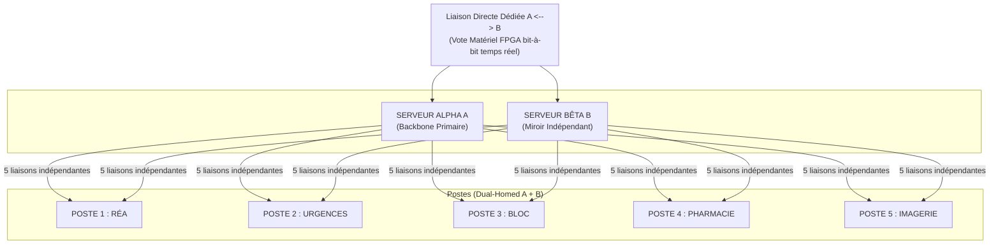

# Livre Blanc : Écosystème Octet-Économe et Architecture en Miroir Destructif

Le web moderne souffre d'une obésité structurelle et d'une vulnérabilité systémique face à l'évolution des attaques de type ransomware et des compromissions de réseaux internes. Ce document présente une architecture de résilience fondée sur un pari conceptuel : au lieu d'isoler les menaces par la logique, on les neutralise au niveau matériel et signal en multipliant les chemins, la redondance et le vote binaire.

## 1. Le Protocole Octet-Économe : Web Binaire et Stéganographie
Le code HTML verbeux est remplacé par un flux binaire natif, éliminant la charge d'analyse syntaxique.

* **Compression Matérielle (Le Bit Unique) :** L'encodage quitte la norme ASCII de 8 bits. Il repose sur un arbre de Huffman asymétrique intégré directement dans un navigateur dédié ou au niveau du noyau de traitement.
* **Chiffrement par l'Espacement :** La donnée n'est pas protégée par une altération mathématique des caractères. L'encodage structurel repose sur la gestion des espaces, rendant l'information dissimulée dans la géométrie du flux.
* **Écologie Numérique :** Ce format binaire garantit un gain de stockage de plus de 50 % à la source, réduisant massivement l'empreinte carbone des serveurs et les besoins en bande passante.

## 2. Le Miroir Destructif : Sécurité Asymétrique Absolue
Le système délaisse la défense périmétrique logicielle classique au profit d'une architecture de leurres réactifs.

* **Essaim de Clones Inversés :** Les utilisateurs n'ont jamais accès à la base de données mère et interagissent exclusivement avec un essaim de clones jetables. Le clone exposé est délibérément non écrivant et sert de couche d'exposition.
* **Destruction Réactive :** Un processus de vérification purement symétrique observe le clone. Au premier octet modifié par un processus non autorisé, le clone est instantanément pulvérisé ou neutralisé.
* **Séparation Physique des Privilèges :** L'application d'une modification sur la base de données maître nécessite obligatoirement l'insertion d'une clé cryptographique matérielle par un administrateur physiquement présent.

### Architecture de redondance physique et de vote matériel

La topologie ci-dessous illustre le principe de redondance active et de validation bit-à-bit entre deux chemins indépendants :



Cette architecture vise à éliminer tout point de rupture unique : les serveurs Alpha et Bêta fonctionnent en miroir, les postes sont dual-homed sur les deux chemins, et la comparaison bit à bit est assurée par un mécanisme de vote matériel en temps réel.

### Vue système — Niveau 0

```mermaid
flowchart LR
  U[Soignants / Postes (Dual-Homed)]
  Net[Réseau dual<br/>(Chemin Alpha ↔ Chemin Bêta)]
  A[Serveur ALPHA<br/>(Backbone primaire)]
  B[Serveur BÊTA<br/>(Miroir indépendant)]
  V[Nœud de vote matériel (FPGA)<br/>comparaison bit-à-bit, latence déterministe]
  CL[Clones jetables (Lecture seule)]
  M[Base maître (Écriture protégée)]
  K[Clé matérielle & Présence physique<br/>(required pour écriture)]

  U --> Net
  Net --> A
  Net --> B

  A --> V
  B --> V

  V -->|OK| CL
  V -->|Divergence → Isolation / Purge| CL
  V -->|Write request (signed)| M
  K -.->|autorise| M

  note right of V
    Plan de gestion: PTP / QoS / Monitoring / SIEM
  end
```

### Vue matérielle / signal — Niveau 2 (FPGA + logique de vote)

```mermaid
flowchart TB
  subgraph PATHS["Entrées physiques (chemins indépendants)"]
    PA[Optique / Cuivre A - Rx]
    PB[Optique / Cuivre B - Rx]
  end

  subgraph HW["Nœud matériel (FPGA)"]
    SERDES_A[SERDES A<br/>(deserialization)]
    SERDES_B[SERDES B]
    CLK_REC_A[Clock recovery A]
    CLK_REC_B[Clock recovery B]
    PTP[PTP / Reference Time]
    ALIGN[FIFO d'alignement (elastic buffer)]
    BIT_COMP[Comparateur bit-à-bit (XOR)]
    WINDOW[Fenêtre temporelle / alignement]
    CRCCHK[CRC / Hash per block]
    VOTE_LOGIC[Logique de vote / validité]
    DECODER[Décodeur stéganographique<br/>(1 = espace, 0+8bits)]
    OUT_BUFFER[Buffer de sortie sécurisé]
    HSM[HSM / TPM (signature, clés)]
    WATCHDOG[Watchdog & Timeout]
    TRIGGER[Trigger sécurité]
    ALARM[Alarme / SIEM logging]
    ACTUATOR[Interface d'isolation réseau / purge hardware]
  end

  PA --> SERDES_A --> CLK_REC_A --> ALIGN --> BIT_COMP
  PB --> SERDES_B --> CLK_REC_B --> ALIGN --> BIT_COMP

  PTP -.-> CLK_REC_A
  PTP -.-> CLK_REC_B
  PTP -.-> WINDOW

  BIT_COMP --> CRCCHK --> VOTE_LOGIC
  WINDOW --> VOTE_LOGIC
  WATCHDOG --> VOTE_LOGIC

  VOTE_LOGIC -->|identique| DECODER
  VOTE_LOGIC -->|divergence| TRIGGER

  DECODER --> OUT_BUFFER --> HSM
  HSM -->|signed request| OUT_BUFFER

  TRIGGER --> ALARM
  TRIGGER --> ACTUATOR
  TRIGGER -->|log| ALARM

  ACTUATOR -->|coupure/purge| PATHS
  ALARM -->|envoi| SIEM[(SIEM / Monitoring)]

  note right of BIT_COMP
    Échantillonnage à fréquence fixe — jitter ≤ seuil
  end

  note right of HSM
    Clés protégées, preuve d'autorisation physique requise
  end
```

Le nœud de vote FPGA constitue le cœur de l'architecture. Il compare les flux Alpha et Bêta bit-à-bit à partir de deux chemins physiques indépendants, avec un alignement temporel strict, un contrôle de synchronisation par PTP, et un mécanisme de déclenchement de sécurité immédiat en cas de divergence. La logique de sécurité agit alors sur les points de coupure physiques et la purge des segmentations compromise.

## 3. Feuille de Route et Appel aux Contributeurs
Ce modèle nécessite un effort communautaire open-source pour passer de la conception théorique à l'implémentation mondiale.

* **Ingénierie Bas Niveau (C, Rust, WebAssembly) :** Création du compilateur textuel vers binaire avec respect de l'arbre asymétrique (Espace = bit 1), et développement du moteur de rendu pour le navigateur dédié.
* **Architecture Réseau :** Conception du protocole de transmission propriétaire empêchant toute rétro-ingénierie d'un flux intercepté.
* **Sécurité Offensive (Red Team) :** Audit des mécanismes de vérification en miroir et validation de la vitesse d'autodestruction face aux scripts d'exploitation automatisés.

---

## ANNEXE : Preuve de Concept - Compilateur Asymétrique Octet-Économe
*Ce script démontre la viabilité mathématique de la compression native où le bit `1` représente l'espace.*

```python
# =============================================
# Octet-Économe - Compresseur HTML Asymétrique
# 1 bit (1) = Espace | 0 + Huffman = Autres
# =============================================

import os
import heapq
from collections import Counter
import tkinter as tk
from tkinter import filedialog, messagebox, scrolledtext

class Node:
    def __init__(self, char=None, freq=0):
        self.char = char
        self.freq = freq
        self.left = None
        self.right = None

    def __lt__(self, other):
        return self.freq < other.freq

def build_asymmetric_codes(text):
    # 1. Isoler l'espace et compter le reste
    freq = Counter(c for c in text if c != " ")
    
    # 2. Arbre de Huffman classique pour le reste du texte
    heap = [Node(char, count) for char, count in freq.items()]
    heapq.heapify(heap)

    while len(heap) > 1:
        left = heapq.heappop(heap)
        right = heapq.heappop(heap)
        merged = Node(freq=left.freq + right.freq)
        merged.left = left
        merged.right = right
        heapq.heappush(heap, merged)

    codes = {}
    
    # 3. Génération des codes avec préfixe '0' obligatoire
    def generate_codes(node, current_code):
        if node is None:
            return
        if node.char is not None:
            codes[node.char] = "0" + current_code
        generate_codes(node.left, current_code + "0")
        generate_codes(node.right, current_code + "1")

    if heap:
        if heap[0].char is not None:
            codes[heap[0].char] = "0"
        else:
            generate_codes(heap[0], "")

    # 4. Assigner le bit unique à l'espace
    codes[" "] = "1"
    
    return codes

def encode_text(text, codes):
    return "".join(codes.get(char, "") for char in text)

def compress_file():
    filepath = filedialog.askopenfilename(
        title="Sélectionner un fichier HTML",
        filetypes=[("Fichiers HTML", "*.html *.htm")]
    )
    if not filepath:
        return

    try:
        with open(filepath, "r", encoding="utf-8") as f:
            text = f.read()

        codes = build_asymmetric_codes(text)
        compressed = encode_text(text, codes)

        output_path = filepath + ".octet"
        with open(output_path, "w", encoding="utf-8") as f:
            f.write(compressed)

        original_size = len(text.encode("utf-8"))
        compressed_size = (len(compressed) + 7) // 8

        gain = (1 - compressed_size / original_size) * 100 if original_size > 0 else 0

        messagebox.showinfo(
            "Compression terminée",
            f"Fichier original : {original_size} octets\n"
            f"Fichier compressé : {compressed_size} octets\n"
            f"Gain réel : {gain:.1f} %\n\n"
            f"La règle asymétrique (Espace = 1) a été respectée.\n"
            f"Sauvegardé : {output_path}"
        )

    except Exception as e:
        messagebox.showerror("Erreur", str(e))

# Interface
root = tk.Tk()
root.title("Octet-Économe - Preuve de Concept Asymétrique")
root.geometry("600x350")
tk.Label(root, text="Octet-Économe", font=("Arial", 16, "bold")).pack(pady=10)
tk.Label(root, text="Compresseur HTML Natif (Arbre Asymétrique)", font=("Arial", 10)).pack(pady=5)
btn_compress = tk.Button(root, text="Compiler le fichier HTML", command=compress_file, bg="#2196F3", fg="white", font=("Arial", 12, "bold"), height=2)
btn_compress.pack(pady=30)
tk.Label(root, text="Architecture Inviolable - Le bit '1' est exclusivement réservé au vide.", fg="gray").pack(side="bottom", pady=20)
root.mainloop()
```

Cette architecture vise à éliminer le point de rupture unique :
- les serveurs Alpha et Bêta fonctionnent en miroir ;
- les postes sont dual-homed sur les deux chemins ;
- la comparaison de flux est en temps réel ;
- toute divergence devient un signal de sécurité, pas un simple incident technique.

### 3.2 Vote binaire et validation bit-à-bit

Le moteur central de cette architecture est un nœud de vote matériel. Deux chemins indépendants sont comparés sous un contrôle strict de synchronisation, de latence et de validité.

Le système peut alors :
- valider l’identité du flux ;
- détecter une divergence instantanément ;
- couper le chemin compromis ;
- lancer la purge, l’isolation ou la reconstruction de la vue exposée.

Le support de validation est matériel, ce qui le rend moins vulnérable à l’ingénierie logicielle classique et plus résistant aux attaques de niveau applicatif.

## 4. Vue système : niveau 0

```mermaid
flowchart LR
  U[Soignants / Postes (Dual-Homed)]
  Net[Réseau dual<br/>(Chemin Alpha ↔ Chemin Bêta)]
  A[Serveur ALPHA<br/>(Backbone primaire)]
  B[Serveur BÊTA<br/>(Miroir indépendant)]
  V[Nœud de vote matériel (FPGA)<br/>comparaison bit-à-bit, latence déterministe]
  CL[Clones jetables (Lecture seule)]
  M[Base maître (Écriture protégée)]
  K[Clé matérielle & Présence physique<br/>(required pour écriture)]

  U --> Net
  Net --> A
  Net --> B

  A --> V
  B --> V

  V -->|OK| CL
  V -->|Divergence → Isolation / Purge| CL
  V -->|Write request (signed)| M
  K -.->|autorise| M

  note right of V
    Plan de gestion: PTP / QoS / Monitoring / SIEM
  end
```

Cette vue fonctionnelle montre la logique complète :
- les postes sont connectés à deux chemins indépendants ;
- les serveurs principaux sont redondés ;
- la cohérence du flux est contrôlée par un moteur matériel ;
- les données exposées sont des clones de lecture, pas des sources de vérité ;
- les demandes d’écriture sont signées, authentifiées et soumises à une autorisation matérielle.

Cette disposition permet de réduire la ligne de survie de l’attaquant et de rendre la compromission moins rentable.

## 5. Vue matérielle et signal : niveau 2

```mermaid
flowchart TB
  subgraph PATHS["Entrées physiques (chemins indépendants)"]
    PA[Optique / Cuivre A - Rx]
    PB[Optique / Cuivre B - Rx]
  end

  subgraph HW["Nœud matériel (FPGA)"]
    SERDES_A[SERDES A<br/>(deserialization)]
    SERDES_B[SERDES B]
    CLK_REC_A[Clock recovery A]
    CLK_REC_B[Clock recovery B]
    PTP[PTP / Reference Time]
    ALIGN[FIFO d'alignement (elastic buffer)]
    BIT_COMP[Comparateur bit-à-bit (XOR)]
    WINDOW[Fenêtre temporelle / alignement]
    CRCCHK[CRC / Hash per block]
    VOTE_LOGIC[Logique de vote / validité]
    DECODER[Décodeur stéganographique<br/>(1 = espace, 0+8bits)]
    OUT_BUFFER[Buffer de sortie sécurisé]
    HSM[HSM / TPM (signature, clés)]
    WATCHDOG[Watchdog & Timeout]
    TRIGGER[Trigger sécurité]
    ALARM[Alarme / SIEM logging]
    ACTUATOR[Interface d'isolation réseau / purge hardware]
  end

  PA --> SERDES_A --> CLK_REC_A --> ALIGN --> BIT_COMP
  PB --> SERDES_B --> CLK_REC_B --> ALIGN --> BIT_COMP

  PTP -.-> CLK_REC_A
  PTP -.-> CLK_REC_B
  PTP -.-> WINDOW

  BIT_COMP --> CRCCHK --> VOTE_LOGIC
  WINDOW --> VOTE_LOGIC
  WATCHDOG --> VOTE_LOGIC

  VOTE_LOGIC -->|identique| DECODER
  VOTE_LOGIC -->|divergence| TRIGGER

  DECODER --> OUT_BUFFER --> HSM
  HSM -->|signed request| OUT_BUFFER

  TRIGGER --> ALARM
  TRIGGER --> ACTUATOR
  TRIGGER -->|log| ALARM

  ACTUATOR -->|coupure/purge| PATHS
  ALARM -->|envoi| SIEM[(SIEM / Monitoring)]

  note right of BIT_COMP
    Échantillonnage à fréquence fixe — jitter ≤ seuil
  end

  note right of HSM
    Clés protégées, preuve d'autorisation physique requise
  end
```

Le nœud de vote FPGA constitue le cœur de l’architecture. Il compare les flux Alpha et Bêta bit-à-bit depuis deux chemins physiques indépendants. L’alignement temporel est strict, la synchronisation repose sur des mécanismes de référence, et toute anomalie est immédiatement interprétée comme un événement critique.

La logique qui suit enchaîne ensuite :
- comparaison de blocs ;
- vérification de cohérence du signal ;
- validation de l’intégrité ;
- déclenchement d’isolation ou de purges automatisées.

C’est une architecture orientée vers la résilience du signal, et non vers la simple correction applicative.

## 6. Feuille de route et appel aux contributeurs

Ce modèle dépasse le cadre d’un concept de sécurité isolé. Il constitue une proposition d’architecture qui exige un effort multidisciplinaire pour passer du concept au système exploitable.

Les axes de développement sont clairs :

- Ingénierie bas niveau :
  - développement de compilateurs textuels vers binaire ;
  - optimisation de l’arbre asymétrique ;
  - moteur de rendu dédié et robuste.

- Architecture réseau :
  - protocoles résilients à la manipulation ;
  - gestion de la redondance active ;
  - mécanismes de validation du flux en temps réel.

- Sécurité offensive :
  - audit de robustesse ;
  - simulations de compromission interne ;
  - validation des temps de réaction et de neutralisation.

- Validation matérielle :
  - preuve de concept avec FPGA ;
  - intégration de mécanismes de vote ;
  - sécurisation des clés et des éléments de signature.

Le but n’est pas de produire un système “parfait”, mais un système dans lequel la compromission, la corruption ou l’injection ne peuvent pas conduire à la perte totale de la donnée ou de la continuité de service.

## Conclusion

L’écosystème Octet-Économe introduit une logique de sécurité structurelle fondée sur la réduction de la surface exploitable, la séparation des privilèges, la redondance physique et la neutralisation rapide des événements anormaux.

Il ne cherche pas uniquement à bloquer la menace dans la couche applicative. Il la déstructures à la source, au niveau du signal, de la donnée et de la topologie du système. La logique n’est plus de “défendre un périmètre” mais de rendre l’attaque impossible à stabiliser, à exploiter durablement et à transformer en avantage opérationnel.

Il s’agit d’un modèle conceptuel, mais il ouvre une voie claire : les infrastructures critiques doivent être conçues moins comme des systèmes de calcul classiques que comme des structures de résilience où la validité du signal, la séparation des privilèges et la redondance matérielle deviennent des éléments de sécurité actifs.
