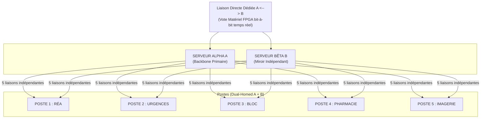

# Livre Blanc : Écosystème Octet-Économe et Architecture en Miroir Destructif

Le web moderne souffre d'une obésité structurelle et d'une vulnérabilité systémique face à l'évolution des attaques de type ransomware et des compromissions de réseaux internes. Ce document présente un modèle d'architecture visant à réduire la surface exploitable et augmenter la résilience des infrastructures critiques.

## 1. Le Protocole Octet-Économe : Web Binaire et Stéganographie
Le code HTML verbeux est remplacé par un flux binaire natif, éliminant la charge d'analyse syntaxique.

* **Compression Matérielle (Le Bit Unique) :** L'encodage quitte la norme ASCII de 8 bits. Il repose sur un arbre de Huffman asymétrique intégré directement dans un navigateur dédié ou au niveau du moteur de rendu.
* **Chiffrement par l'Espacement :** La donnée n'est pas protégée par une altération mathématique des caractères. L'encodage structurel repose sur la gestion des espaces, rendant l'information moins triviale à interpréter pour un attaquant non informé.
* **Écologie Numérique :** Ce format binaire garantit un gain de stockage significatif à la source, réduisant l'empreinte carbone des serveurs et les besoins en bande passante.

## 2. Le Miroir Destructif : Sécurité Asymétrique Absolue
Le système délaisse la défense périmétrique logicielle classique au profit d'une architecture de leurres réactifs.

* **Essaim de Clones Inversés :** Les utilisateurs n'ont jamais accès à la base de données mère et interagissent exclusivement avec un essaim de clones jetables.
* **Destruction Réactive :** Un processus de vérification observe le clone. Au premier octet modifié par un processus non autorisé, le clone est instantanément isolé et purgé.
* **Séparation Physique des Privilèges :** L'application d'une modification sur la base de données maître nécessite obligatoirement l'insertion d'une clé cryptographique matérielle par un administrateur physique.

### Architecture de redondance physique et de vote matériel

La topologie ci-dessous illustre le principe de redondance active et de validation bit-à-bit entre deux chemins indépendants :



Cette architecture vise à éliminer tout point de rupture unique : les serveurs Alpha et Bêta fonctionnent en miroir, les postes sont dual-homed sur les deux chemins, et la comparaison bit à bit est effectuée par un nœud matériel dédié.

### Vue système — Niveau 0

```mermaid
flowchart LR
  U[Soignants / Postes (Dual-Homed)]
  Net[Réseau dual<br/>(Chemin Alpha ↔ Chemin Bêta)]
  A[Serveur ALPHA<br/>(Backbone primaire)]
  B[Serveur BÊTA<br/>(Miroir indépendant)]
  V[Nœud de vote matériel (FPGA)<br/>comparaison bit-à-bit, latence déterministe]
  CL[Clones jetables (Lecture seule)]
  M[Base maître (Écriture protégée)]
  K[Clé matérielle & Présence physique<br/>(required pour écriture)]

  U --> Net
  Net --> A
  Net --> B

  A --> V
  B --> V

  V -->|OK| CL
  V -->|Divergence → Isolation / Purge| CL
  V -->|Write request (signed)| M
  K -.->|autorise| M

  note right of V
    Plan de gestion: PTP / QoS / Monitoring / SIEM
  end
```

### Vue matérielle / signal — Niveau 2 (FPGA + logique de vote)

```mermaid
flowchart TB
  subgraph PATHS["Entrées physiques (chemins indépendants)"]
    PA[Optique / Cuivre A - Rx]
    PB[Optique / Cuivre B - Rx]
  end

  subgraph HW["Nœud matériel (FPGA)"]
    SERDES_A[SERDES A<br/>(deserialization)]
    SERDES_B[SERDES B]
    CLK_REC_A[Clock recovery A]
    CLK_REC_B[Clock recovery B]
    PTP[PTP / Reference Time]
    ALIGN[FIFO d'alignement (elastic buffer)]
    BIT_COMP[Comparateur bit-à-bit (XOR)]
    WINDOW[Fenêtre temporelle / alignement]
    CRCCHK[CRC / Hash per block]
    VOTE_LOGIC[Logique de vote / validité]
    DECODER[Décodeur stéganographique<br/>(1 = espace, 0+8bits)]
    OUT_BUFFER[Buffer de sortie sécurisé]
    HSM[HSM / TPM (signature, clés)]
    WATCHDOG[Watchdog & Timeout]
    TRIGGER[Trigger sécurité]
    ALARM[Alarme / SIEM logging]
    ACTUATOR[Interface d'isolation réseau / purge hardware]
  end

  PA --> SERDES_A --> CLK_REC_A --> ALIGN --> BIT_COMP
  PB --> SERDES_B --> CLK_REC_B --> ALIGN --> BIT_COMP

  PTP -.-> CLK_REC_A
  PTP -.-> CLK_REC_B
  PTP -.-> WINDOW

  BIT_COMP --> CRCCHK --> VOTE_LOGIC
  WINDOW --> VOTE_LOGIC
  WATCHDOG --> VOTE_LOGIC

  VOTE_LOGIC -->|identique| DECODER
  VOTE_LOGIC -->|divergence| TRIGGER

  DECODER --> OUT_BUFFER --> HSM
  HSM -->|signed request| OUT_BUFFER

  TRIGGER --> ALARM
  TRIGGER --> ACTUATOR
  TRIGGER -->|log| ALARM

  ACTUATOR -->|coupure/purge| PATHS
  ALARM -->|envoi| SIEM[(SIEM / Monitoring)]

  note right of BIT_COMP
    Échantillonnage à fréquence fixe — jitter ≤ seuil
  end

  note right of HSM
    Clés protégées, preuve d'autorisation physique requise
  end
```

## 3. Feuille de Route et Appel aux Contributeurs

Ce modèle nécessite un effort communautaire open-source pour passer de la conception théorique à l'implémentation mondiale.

* **Ingénierie Bas Niveau (C, Rust, WebAssembly) :** Création du compilateur textuel vers binaire avec respect de l'arbre asymétrique (Espace = bit 1), et développement du moteur de rendu.
* **Architecture Réseau :** Conception du protocole de transmission propriétaire empêchant toute rétro-ingénierie d'un flux intercepté.
* **Sécurité Offensive (Red Team) :** Audit des mécanismes de vérification en miroir et validation de la vitesse d'autodestruction face aux scripts d'exploitation automatisés.

---

## ANNEXE : Preuve de Concept - Compilateur Asymétrique Octet-Économe

La preuve de concept originale (un script Python inclus dans la version précédente du document) a été extraite vers tools/octet_compressor.py. Ce script fournit :

- la génération d'un dictionnaire de codes asymétriques (espace = '1'),
- l'encodage d'un texte en un fichier binaire .octet (en-tête JSON contenant la table de codes + payload binaire),
- le décodage pour vérification de roundtrip.

Pour exécuter la preuve de concept (depuis la racine du dépôt) :

```bash
python -m tools.octet_compressor --input examples/sample.html --output examples/sample.html.octet
python -m tools.octet_compressor --decode --input examples/sample.html.octet --output examples/sample.decoded.html
```

Un test minimal est disponible dans tests/test_poc_encode_decode.py pour vérifier un encodage/décodage roundtrip.

---

## Conclusion

L'écosystème Octet-Économe introduit une logique de sécurité structurelle fondée sur la réduction de la surface exploitable, la séparation des privilèges, la redondance physique et la validation matérielle des flux. Le dépôt contient maintenant une preuve de concept exécutable et des éléments de documentation pour faciliter la contribution.
