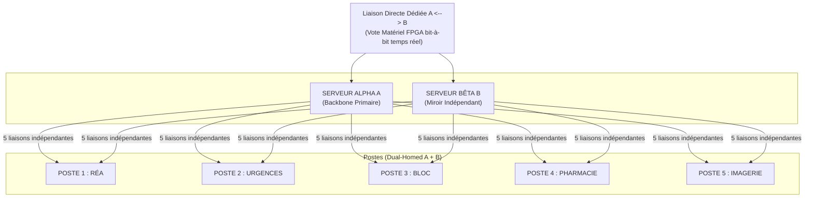

# Livre Blanc : Écosystème Octet-Économe et Architecture en Miroir Destructif

## Résumé exécutif

Le web moderne souffre d’une obésité structurelle, d’une dépendance excessive aux couches logicielles abstraites et d’une vulnérabilité croissante face aux menaces internes et externes, notamment les attaques de type ransomware, la compromission des systèmes d’accès et l’exploitation des points de rupture de la chaîne applicative.

Les architectures de sécurité traditionnelles se fondent encore sur la défense périmétrique, les filtres de flux, les contrôles d’accès et les correctifs applicatifs. Ces mécanismes restent utiles, mais ils ne suffisent plus face à des menaces qui agissent à la fois sur les couches réseau, applicative et opératoire. La difficulté ne réside pas uniquement dans l’exploitation d’une faille, mais dans la capacité à détruire, corrompre ou détourner la donnée et la logique de décision au cœur du système.

Ce document présente une proposition de sécurité fondée sur une architecture de résilience structurée autour de trois principes :
- réduction de la surface exploitable du flux numérique ;
- séparation stricte des privilèges et des rôles ;
- redondance physique active avec validation matérielle et vote binaire.

L’objectif est de développer un système où la donnée d’origine ne peut être exposée dans un environnement de travail standard, où les copies accessibles sont des vues non souveraines, et où toute divergence ou altération devient immédiatement détectée, isolée et neutralisée.

Le modèle défendu ici repose sur un changement de paradigme : au lieu de renforcer la défense logique d’un système déjà trop centralisé, on recompose l’architecture pour rendre l’attaque moins rentable, moins durable et moins exploitable.

## 1. Le protocole Octet-Économe : compression binaire et dissimulation du signal

La plupart des systèmes numériques modernes sont construits autour de flux textuels, de protocoles verbaux, d’interfaces complexes et de couches d’abstraction qui multiplient les points d’entrée. Le code HTML, les feuilles de style, les scripts, les bibliothèques de rendu et les interpréteurs associés augmentent la surface d’attaque et compliquent l’analyse de sécurité.

Le protocole Octet-Économe propose une logique inverse : le contenu n’est plus pensé comme un ensemble de caractères de représentation générale, mais comme un flux binaire optimisé, compact et intentionnellement structuré. Cette approche cherche à diminuer la quantité d’information utile exposée, tout en créant un signal plus difficile à analyser avec les outils standards.

### 1.1 Compression matérielle et codage asymétrique

Le système repose sur une règle de codage asymétrique dans laquelle le bit 1 est réservé à l’espace. Cela permet de réduire la densité utile du flux, d’éliminer des éléments redondants et de rendre les structures du signal moins reconnaissables pour les composants neutres ou hostiles du réseau.

Les conséquences sont significatives :
- réduction de la taille des flux ;
- diminution des temps de traitement ;
- baisse de la charge sur les moteurs de rendu ;
- réduction de la surface exploitable du contenu ;
- meilleure efficacité énergétique globale.

Le point clé n’est pas seulement la compression, mais la transformation de la donnée en signal plus dense, plus compact et plus difficile à disséquer.

### 1.2 Chiffrement par l’espacement

Le protocole ne s’appuie pas uniquement sur un chiffrement mathématique classique. Il protège la donnée en modifiant la géométrie du flux. L’information ne réside pas uniquement dans le contenu, mais dans la relation entre les éléments du signal : espace, rythme, longueur, séquencement, structure et distribution des bits.

Cette logique produit un mécanisme de dissimulation active :
- la donnée est structurée dans un espace de représentation moins lisible ;
- les analyses heuristiques sont déstabilisées ;
- les mécanismes de détection conventionnels peinent à distinguer le contenu de la structure ;
- les flux interceptés présentent une sémantique altérée ou fragmentée.

La sécurité n’est donc plus seulement un enjeu d’algorithme, mais également un enjeu de topologie du signal.

### 1.3 Écologie numérique et efficacité structurelle

Le modèle Octet-Économe n’est pas un simple exercice théorique. Il apporte un gain d’efficience tangible :
- réduction de la bande passante nécessaire ;
- diminution des coûts de stockage ;
- baisse de l’empreinte carbone des infrastructures ;
- réduction des charges CPU et mémoire sur les équipements de bord ;
- meilleure stabilité dans les environnements contraints.

L’écologie numérique devient ainsi un corollaire de la sécurité structurelle : un système plus léger et plus dense est, par définition, plus difficile à observer, analyser et exploiter.

## 2. Le Miroir Destructif : sécurité asymétrique absolue

La notion centrale de cette architecture consiste à ne jamais exposer la donnée originale dans un environnement d’exploitation standard. La donnée “mère” est stockée dans un espace sécurisé, distinct, isolé et soumis à des mécanismes d’accès strictement contrôlés. Les utilisateurs interagissent uniquement avec des copies dérivées, non souveraines, non persistantes et non écrivantes.

### 2.1 Clones jetables et séparation des privilèges

Les clones exposés sont intégrés dans une logique de non-souveraineté. Ils ne sont ni la source de vérité, ni une couche d’authenticité, ni un support d’écriture. Ils servent de couche d’exposition, de service et de réplique de travail.

Le système est construit pour que :
- la donnée maître reste hors du périmètre d’exposition ;
- la copie visible soit facilement remplaçable ;
- les instances exposées soient limitées à un rôle de lecture ou de traitement ;
- toute anomalie soit détectée avant qu’elle ne devienne un point d’entrée exploitable.

Cette séparation de la source et de la copie est essentielle. Elle empêche l’attaquant de travailler sur la donnée authentique et rend l’extraction de la source plus coûteuse, plus visible et plus fragile.

### 2.2 Destruction réactive

La sécurité ne repose pas sur l’idée que l’attaque ne peut pas se produire. Elle repose sur l’idée que l’attaque ne peut pas se stabiliser ni perdurer.

Lorsqu’un octet est modifié de manière non autorisée :
- la copie exposée est immédiatement isolée ;
- l’instance compromise est détruite ou purgée ;
- le flux est coupé ou réinitialisé ;
- un nouvel environnement sain est restauré de manière automatique.

Le principe de destruction réactive transforme la sécurité en mécanisme de neutralisation rapide plutôt que de simple détection retardée. L’objectif n’est pas seulement de signaler l’incident, mais de rendre l’incident non exploitable.

### 2.3 Séparation physique des privilèges

L’écriture sur la base maîtresse exige une validation matérielle explicite. La modification de la source n’est pas une action logique “ouverte” dans le système exposé. Elle nécessite :
- une clé cryptographique protégée ;
- une présence physique d’un administrateur habilité ;
- une validation hors réseau ou isolée ;
- une journalisation de l’action dans un environnement sécurisé.

Cela élimine la logique classique où l’écriture est traitée comme un simple privilège logique. Dans cette architecture, l’autorisation d’écriture est un acte matériel, vérifiable, et dissocié du périmètre opérationnel.

## 3. Architecture de redondance physique et de vote matériel

L’une des composantes les plus décisives du système est la redondance active. Il ne suffit pas de dupliquer un service ; il faut créer une architecture où deux chemins indépendants sont confrontés en temps réel, et où toute divergence devient un signal de sécurité.

### 3.1 Topologie de redondance active

La topologie ci-dessous illustre la logique de redondance et de validation concurrente :



Cette architecture vise à éliminer le point de rupture unique :
- les serveurs Alpha et Bêta fonctionnent en miroir ;
- les postes sont dual-homed sur les deux chemins ;
- la comparaison de flux est en temps réel ;
- toute divergence devient un signal de sécurité, pas un simple incident technique.

### 3.2 Vote binaire et validation bit-à-bit

Le moteur central de cette architecture est un nœud de vote matériel. Deux chemins indépendants sont comparés sous un contrôle strict de synchronisation, de latence et de validité.

Le système peut alors :
- valider l’identité du flux ;
- détecter une divergence instantanément ;
- couper le chemin compromis ;
- lancer la purge, l’isolation ou la reconstruction de la vue exposée.

Le support de validation est matériel, ce qui le rend moins vulnérable à l’ingénierie logicielle classique et plus résistant aux attaques de niveau applicatif.

## 4. Vue système : niveau 0

```mermaid
flowchart LR
  U[Soignants / Postes (Dual-Homed)]
  Net[Réseau dual<br/>(Chemin Alpha ↔ Chemin Bêta)]
  A[Serveur ALPHA<br/>(Backbone primaire)]
  B[Serveur BÊTA<br/>(Miroir indépendant)]
  V[Nœud de vote matériel (FPGA)<br/>comparaison bit-à-bit, latence déterministe]
  CL[Clones jetables (Lecture seule)]
  M[Base maître (Écriture protégée)]
  K[Clé matérielle & Présence physique<br/>(required pour écriture)]

  U --> Net
  Net --> A
  Net --> B

  A --> V
  B --> V

  V -->|OK| CL
  V -->|Divergence → Isolation / Purge| CL
  V -->|Write request (signed)| M
  K -.->|autorise| M

  note right of V
    Plan de gestion: PTP / QoS / Monitoring / SIEM
  end
```

Cette vue fonctionnelle montre la logique complète :
- les postes sont connectés à deux chemins indépendants ;
- les serveurs principaux sont redondés ;
- la cohérence du flux est contrôlée par un moteur matériel ;
- les données exposées sont des clones de lecture, pas des sources de vérité ;
- les demandes d’écriture sont signées, authentifiées et soumises à une autorisation matérielle.

Cette disposition permet de réduire la ligne de survie de l’attaquant et de rendre la compromission moins rentable.

## 5. Vue matérielle et signal : niveau 2

```mermaid
flowchart TB
  subgraph PATHS["Entrées physiques (chemins indépendants)"]
    PA[Optique / Cuivre A - Rx]
    PB[Optique / Cuivre B - Rx]
  end

  subgraph HW["Nœud matériel (FPGA)"]
    SERDES_A[SERDES A<br/>(deserialization)]
    SERDES_B[SERDES B]
    CLK_REC_A[Clock recovery A]
    CLK_REC_B[Clock recovery B]
    PTP[PTP / Reference Time]
    ALIGN[FIFO d'alignement (elastic buffer)]
    BIT_COMP[Comparateur bit-à-bit (XOR)]
    WINDOW[Fenêtre temporelle / alignement]
    CRCCHK[CRC / Hash per block]
    VOTE_LOGIC[Logique de vote / validité]
    DECODER[Décodeur stéganographique<br/>(1 = espace, 0+8bits)]
    OUT_BUFFER[Buffer de sortie sécurisé]
    HSM[HSM / TPM (signature, clés)]
    WATCHDOG[Watchdog & Timeout]
    TRIGGER[Trigger sécurité]
    ALARM[Alarme / SIEM logging]
    ACTUATOR[Interface d'isolation réseau / purge hardware]
  end

  PA --> SERDES_A --> CLK_REC_A --> ALIGN --> BIT_COMP
  PB --> SERDES_B --> CLK_REC_B --> ALIGN --> BIT_COMP

  PTP -.-> CLK_REC_A
  PTP -.-> CLK_REC_B
  PTP -.-> WINDOW

  BIT_COMP --> CRCCHK --> VOTE_LOGIC
  WINDOW --> VOTE_LOGIC
  WATCHDOG --> VOTE_LOGIC

  VOTE_LOGIC -->|identique| DECODER
  VOTE_LOGIC -->|divergence| TRIGGER

  DECODER --> OUT_BUFFER --> HSM
  HSM -->|signed request| OUT_BUFFER

  TRIGGER --> ALARM
  TRIGGER --> ACTUATOR
  TRIGGER -->|log| ALARM

  ACTUATOR -->|coupure/purge| PATHS
  ALARM -->|envoi| SIEM[(SIEM / Monitoring)]

  note right of BIT_COMP
    Échantillonnage à fréquence fixe — jitter ≤ seuil
  end

  note right of HSM
    Clés protégées, preuve d'autorisation physique requise
  end
```

Le nœud de vote FPGA constitue le cœur de l’architecture. Il compare les flux Alpha et Bêta bit-à-bit depuis deux chemins physiques indépendants. L’alignement temporel est strict, la synchronisation repose sur des mécanismes de référence, et toute anomalie est immédiatement interprétée comme un événement critique.

La logique qui suit enchaîne ensuite :
- comparaison de blocs ;
- vérification de cohérence du signal ;
- validation de l’intégrité ;
- déclenchement d’isolation ou de purges automatisées.

C’est une architecture orientée vers la résilience du signal, et non vers la simple correction applicative.

## 6. Feuille de route et appel aux contributeurs

Ce modèle dépasse le cadre d’un concept de sécurité isolé. Il constitue une proposition d’architecture qui exige un effort multidisciplinaire pour passer du concept au système exploitable.

Les axes de développement sont clairs :

- Ingénierie bas niveau :
  - développement de compilateurs textuels vers binaire ;
  - optimisation de l’arbre asymétrique ;
  - moteur de rendu dédié et robuste.

- Architecture réseau :
  - protocoles résilients à la manipulation ;
  - gestion de la redondance active ;
  - mécanismes de validation du flux en temps réel.

- Sécurité offensive :
  - audit de robustesse ;
  - simulations de compromission interne ;
  - validation des temps de réaction et de neutralisation.

- Validation matérielle :
  - preuve de concept avec FPGA ;
  - intégration de mécanismes de vote ;
  - sécurisation des clés et des éléments de signature.

Le but n’est pas de produire un système “parfait”, mais un système dans lequel la compromission, la corruption ou l’injection ne peuvent pas conduire à la perte totale de la donnée ou de la continuité de service.

## Conclusion

L’écosystème Octet-Économe introduit une logique de sécurité structurelle fondée sur la réduction de la surface exploitable, la séparation des privilèges, la redondance physique et la neutralisation rapide des événements anormaux.

Il ne cherche pas uniquement à bloquer la menace dans la couche applicative. Il la déstructures à la source, au niveau du signal, de la donnée et de la topologie du système. La logique n’est plus de “défendre un périmètre” mais de rendre l’attaque impossible à stabiliser, à exploiter durablement et à transformer en avantage opérationnel.

Il s’agit d’un modèle conceptuel, mais il ouvre une voie claire : les infrastructures critiques doivent être conçues moins comme des systèmes de calcul classiques que comme des structures de résilience où la validité du signal, la séparation des privilèges et la redondance matérielle deviennent des éléments de sécurité actifs.
