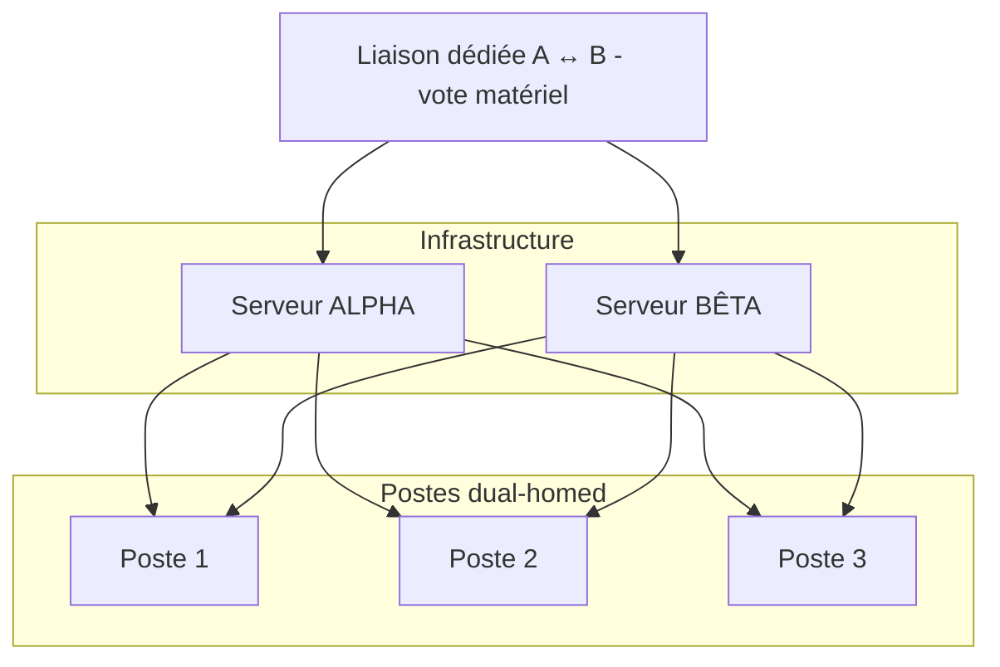
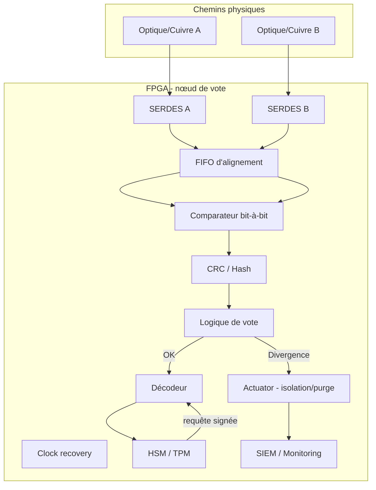

# Livre Blanc — Écosystème Octet‑Économe  
Version : Publication-ready

---

## Résumé exécutif

Le paysage numérique contemporain est confronté à des attaques de plus en plus ciblées (ransomware, compromissions internes) et à une inflation structurelle des formats et des dépenses d'infrastructure. Ce document présente l'architecture Octet‑Économe : une approche de résilience basée sur la réduction de surface exploitable, la redondance matérielle, et une validation matérielle déterministe (vote bit‑à‑bit). L'objectif est d'offrir une solution pour protéger les bases de données critiques et les flux sensibles tout en limitant l'empreinte réseau et stockage.

---

## 1. Contexte et modèle de menace

- Menaces principales : ransomware, élévation de privilèges interne, interception passive et modification active des flux.
- Hypothèses : un adversaire peut compromettre un chemin réseau ou un serveur, mais compromettre simultanément deux chemins physiques indépendants est beaucoup plus coûteux.
- Objectif de sécurité : empêcher la corruption silencieuse des données critiques et limiter l'impact d'une compromission en isolant et purgeant rapidement les segments compromis.

---

## 2. Principes de conception

1. Séparation stricte des privilèges : les opérations d’écriture sur la base maîtresse requièrent une autorisation matérielle et une présence physique.
2. Redondance matérielle : deux chemins physiques indépendants (Alpha / Bêta) et serveurs en miroir pour éliminer les points de rupture uniques.
3. Vote matériel déterministe : comparaison bit‑à‑bit des flux par un nœud FPGA local, avec alignement temporel et détection de divergence.
4. Exposition contrôlée : les utilisateurs lisent des clones jetables (lecture seule) ; les écritures sont signées et exécutées uniquement après validation matérielle.
5. Minimisation de surface logicielle : adoption d’un format binaire compact et d’un moteur d’affichage dédié pour réduire la complexité d’analyse côté client/serveur.

---

## 3. Architecture globale (vue d'ensemble)

La solution se structure en couches :

- Niveau utilisateur : postes dual‑homed (connectés aux deux chemins).
- Niveau réseau : deux chemins physiques indépendants (Alpha / Bêta).
- Niveau backend : serveurs miroir (Alpha, Bêta) et base maîtresse protégée.
- Niveau vote : nœud matériel (FPGA) qui compare les flux, déclenche des actions de sécurité et signe/autorise les écritures.

### Diagramme — Topologie physique (mermaid)


---

## 4. Nœud de vote matériel — conception et flux

Le nœud FPGA est le cœur fonctionnel. Il réalise :

- la désérialisation des flux physiques (SERDES),
- l'alignement temporel (FIFO d'alignement, PTP),
- la comparaison bit‑à‑bit (comparateur / XOR),
- la vérification d'intégrité par bloc (CRC ou hash),
- la logique de vote et la décision (validité/divergence),
- le déclenchement sécuritaire (isolation physique, purge) et l'enregistrement dans le SIEM.

### Diagramme — Vue matérielle (mermaid)


---

## 5. Format binaire et minimisation

Nous proposons un flux binaire natif et compact (arbre de codes asymétrique). Avantages :

- réduction significative du volume transmis et stocké,
- diminution de la surface d’analyse côté logiciel,
- possibilité d’intégrer un décodage stéganographique compatible avec la topologie matérielle.

Remarque : le format doit rester ouvert et auditable. Le caractère « espace = bit 1 » est une convention de preuve de concept à documenter précisément dans l’annexe technique.

---

## 6. Cas d’usage et scénarios opérationnels

- Systèmes hospitaliers critiques (dossiers patients) : maintien des accès lecture pendant qu’une divergence est isolée.
- Systèmes industriels et OT : réduction du risque de sabotage silencieux.
- Plateformes financières sensibles : protection contre altération transactionnelle.

Chacun de ces scénarios impose des contraintes de latence, disponibilité et conformité (journalisation et traçabilité).

---

## 7. Sécurité, détection et réponse

- Déclenchement immédiat sur divergence : isolement physique du segment compromis, purge des clones exposés.
- Journalisation immuable des événements (HSM + SIEM).
- Tests offensifs (Red Team) pour valider le délai de détection et la robustesse face aux attaques de timing et d'injection.
- Gouvernance des clés : HSM/TPM pour protéger les clés de signature et l'exigence de présence physique pour les opérations d'écriture.

---

## 8. Feuille de route et plan d’action

Étapes prioritaires :
1. Prototype FPGA : implémenter le flux d’entrée, comparateur et déclencheur.
2. Format binaire — PoC compilateur : mise en place d’un encodeur/décodeur (C/Rust/Python) et tests round‑trip.
3. Moteur de rendu : navigateur dédié ou module d’intégration front.
4. Tests de sécurité et audits externes (Red Team).
5. Déploiement pilote dans un environnement contrôlé (hôpital/OT).
6. Standardisation et documentation ouverte.

---

## 9. Annexes

### A — Preuve de concept : outil octet_compressor
- scripts et tests disponibles dans tools/octet_compressor.py et tests/test_poc_encode_decode.py.
- Exemple d’exécution :
```bash
python -m tools.octet_compressor --input examples/sample.html --output examples/sample.html.octet
python -m tools.octet_compressor --decode --input examples/sample.html.octet --output examples/sample.decoded.html
```

### B — Glossaire
- Dual‑homed : poste connecté à deux chemins réseau indépendants.
- HSM : module matériel de sécurité (protection des clés).
- PTP : Precision Time Protocol, pour synchronisation temporelle.

---

## Conclusion

L'architecture Octet‑Économe propose un changement de paradigme : passer d'une défense logicielle périmétrique à une sécurité structurelle fondée sur la redondance matérielle et la validation déterministe des flux. Ce modèle ne remplace pas l'ensemble des pratiques de sécurité, mais il offre une brique complémentaire forte pour protéger les systèmes critiques contre les altérations silencieuses et les attaques massives.
